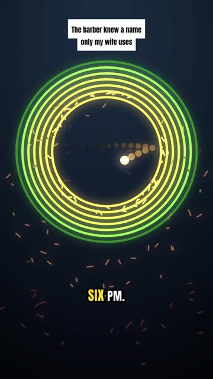

# storygen

Story-time shorts made from scratch, fully unattended and on a free stack. Each clip has:

- **a made-up mystery / horror / tension story written to hold attention** (dark secrets, cheating partners,
  someone in the house, messages that should not exist), by Claude through headless `claude -p` (your Claude
  Pro plan; no API key). A writer pass drafts the story: a punchy scary first line, an open loop, escalation with
  no filler, then a clear twist and an eerie cliffhanger (a new, concrete danger at its peak, never a vague
  ending). A retention-editor pass then scores the draft, lists its problems and returns a tightened final
  script, plus a YouTube Shorts title, description and hashtags.
- **an expressive offline voice-over** by [Chatterbox Turbo](https://github.com/resemble-ai/chatterbox) (MIT),
  in its own environment (`.venv-tts`), one take per story beat. By default every story has a male narrator whose voice
  is copied from a short reference clip that [Kokoro-82M](https://huggingface.co/hexgrad/Kokoro-82M)
  (Apache-2.0) makes once with its `am_onyx` voice (`[voice].narrator = "female"` or `"auto"` to change that). On a
  6-core CPU it runs at about 4x slower than real time (~6 min per clip). Kokoro alone (`[voice].engine =
  "kokoro"`, ~2x faster than real time, flatter) is the fallback. Long takes are time-stretched (≤ 1.15x) or
  shortened once by Claude. Chatterbox adds Resemble's inaudible watermark to its audio.
- **word-by-word subtitles**: the spoken word is highlighted, the timings come from faster-whisper aligned
  to the script, and the story title stays in a white box at the top.
- **a satisfying background animation**, rendered frame by frame: a ball bouncing under gravity inside
  layered neon rings that slowly close in. Each hit plays a soft note of a minor-key melody, kept low under the voice.
  - `layers`: every ring the ball touches shatters.
  - `escape`: the rings have rotating openings; the ball bounces off the solid parts and a ring shatters
    when the ball slips through its opening.
- **eerie background music**: one of eight CC0 (public-domain) horror tracks from OpenGameArt, listed in
  `assets/music/tracks.tsv` and downloaded by `install.sh`, from a random point, loudness-matched and gently
  ducked while the narrator speaks. Any audio file you drop into `assets/music/` joins the pool.

Output: 1080x1920 H.264 + AAC, at most 58 s, −14 LUFS, plus a thumbnail, the script and the YouTube text
(`youtube.txt`: title, description, hashtags: 7 fixed ones, `#shorts #scarystories #horrorstory #scary #creepy
#horror #storytime`, plus 2 about the story; set in `[story].core_hashtags` / `hashtags`).

This is a sister project of clipgen (shorts cut from long
videos) and has its own Telegram bot.

## Example

A real, unedited clip made by storygen (52.9 s, `layers` background, Chatterbox voice, `creepy.ogg` music bed),
re-encoded to 720p for the repository. Click the image to play it.

<a href="https://github.com/AlbertoPrats/StoryGen/blob/main/docs/example-clip.mp4"></a>

[▶ Watch the example clip (MP4, 9.7 MB)](https://github.com/AlbertoPrats/StoryGen/blob/main/docs/example-clip.mp4)

## Install

```bash
./install.sh                # ffmpeg, venv, Chatterbox (.venv-tts, CPU torch), Kokoro, Anton font, Whisper base, Claude Code
                            # (NO_CHATTERBOX=1 ./install.sh skips Chatterbox; Kokoro is then used)
.venv/bin/storygen doctor   # checks everything, including the Claude login
```

## Use

```bash
.venv/bin/storygen make                                  # one clip, random genre and background
.venv/bin/storygen make -n 3 --style escape
.venv/bin/storygen make --theme "a babysitter finds a second staircase"
.venv/bin/storygen make --story work/stories/<id>/story.json   # re-voice / re-render a story, no Claude call
.venv/bin/storygen bot                                   # Telegram bot
.venv/bin/python -m pytest -q                            # tests (offline)
```

Clips land in `output/<timestamp>_<title>/`. The video and thumbnail are named after the clip's YouTube title
(e.g. `a-barber-with-a-razor-at-my-throat-knew-my-alarm-code.mp4` / `.jpg`), and the MP4 carries its own
metadata: title, description with hashtags, keywords, genre, premise (comment), date and `channel_handle` as
artist. Next to them: `story.json`, `script.txt`, `youtube.txt`.
Working files (story, voice, word timings, hit sounds, captions) are in `work/stories/<timestamp>/`.
Recent premises are kept in `work/story_state.json` and sent to Claude so it does not repeat itself.

## Telegram bot

Create a **new** bot with @BotFather (do not reuse the clipgen bot) and put its token in
`secrets/telegram_token`, in `[telegram].token` of `storygen.toml`, or in `STORYGEN_BOT_TOKEN`. Start
`storygen bot` and open the pairing link it prints, so that you become the bot's only user.

| Message | Result |
|---|---|
| `story` (or any message) | one clip, random dark genre |
| any other text | used as the theme, e.g. `a locked attic and a cat that won't go in` |
| `nX` | X clips (1-10), e.g. `story n3` |
| `scene1` / `scene2` | background: `layers` / `escape` (default random) |
| `/redo` or the 🔁 button | another story with the same settings |
| `/stop`, `/status`, `/help` | cancel the job and drop the queue / show the queue / help |

Each clip comes with its YouTube title and description (with hashtags, in a copyable block) and the
editor's retention score. The full
script follows in a collapsed quote. A clip takes about 7 minutes with Chatterbox. To run it as a service, see `deploy/storygen-bot.service`.

## Config

Copy `storygen.example.toml` to `storygen.toml`; every key is optional. The main knobs are
`[story]` (length, genres, review pass), `[voice]` (voices, speed), `[scene]` (style, physics, hit
sound volume) and `[captions]`.

## Licences of the bundled or downloaded assets

Chatterbox Turbo: MIT. Kokoro-82M weights and voices: Apache-2.0. Anton font: SIL Open Font License. Music: CC0 tracks from
OpenGameArt, credited in `assets/music/tracks.tsv`. The hit sounds and the animation are synthesised in code. The stories are fiction written by Claude for each clip.
